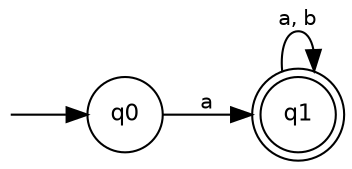

# JFLAP 7.1 Model Context Protocol (MCP) Server Specification

The **JFLAP MCP Server** (`jflap_mcp.py` / `jflap mcp`) implements the open [Model Context Protocol (MCP)](https://modelcontextprotocol.io/) over standard input/output (`stdio`) using JSON-RPC 2.0.

It exposes 10 specialized tools enabling AI models (like Gemini, Claude, GPT) to analyze, simulate, transform, and generate automata theory models.

---

## 1. Tool Index

| Tool | Purpose |
| :--- | :--- |
| `jflap_inspect` | Inspect structure, state table, transitions, alphabet, and determinism. |
| `jflap_simulate` | Batch simulate input strings on any DFA, NFA, PDA, Turing Machine, Mealy, or Moore machine. |
| `jflap_trace` | Generate a step-by-step execution trace showing states, stack, and tape changes. |
| `jflap_fsa_operation` | Convert NFA $\rightarrow$ DFA, minimize DFA, prove language equivalence, or combine automata. |
| `jflap_grammar_operation` | Parse strings using CYK / Brute-force parser, clean grammar rules, or compute FIRST & FOLLOW sets with LL(1) test. |
| `jflap_convert_model` | Cross-convert between FSA $\rightarrow$ RE, FSA $\leftrightarrow$ Regular Grammar, and PDA $\leftrightarrow$ CFG. |
| `jflap_lsystem_expand` | Expand L-System rewriting rules to a specified derivation depth. |
| `jflap_create_model` | Programmatically create a `.jff` file from a JSON definition. |
| `jflap_export_dot` | Export an automaton to Graphviz DOT format for visual rendering. |
| `jflap_launch_gui` | Launch the official interactive JFLAP 7.1 Swing desktop window. |

---

## 2. Tool Schemas & Examples

### 1. `jflap_inspect`
Inspects any `.jff` file and returns structured metadata.

**Parameters:**
```json
{
  "file": "path/to/model.jff"
}
```

**Example Output:**
```json
{
  "file": "C:\\Users\\mridu\\jflap-cli\\examples\\contains_ab_nfa.jff",
  "category": "automaton",
  "type": "fa",
  "states": [
    {"id": 0, "name": "q0", "initial": true, "final": false, "x": 50, "y": 50},
    {"id": 1, "name": "q1", "initial": false, "final": false, "x": 150, "y": 50},
    {"id": 2, "name": "q2", "initial": false, "final": true, "x": 250, "y": 50}
  ],
  "initialState": 0,
  "finalStates": [2],
  "isDeterministic": false,
  "transitions": [
    {"from": 0, "to": 0, "read": "a"},
    {"from": 0, "to": 1, "read": "a"},
    {"from": 1, "to": 2, "read": "b"}
  ]
}
```

---

### 2. `jflap_simulate`
Simulates an array of input strings against an automaton.

**Parameters:**
```json
{
  "file": "path/to/model.jff",
  "inputs": ["ab", "aabb", "bba"]
}
```

**Example Output:**
```json
{
  "file": "path/to/model.jff",
  "results": [
    {"input": "ab", "accepted": true},
    {"input": "aabb", "accepted": true},
    {"input": "bba", "accepted": false}
  ]
}
```

---

### 3. `jflap_trace`
Executes a step-by-step configuration trace of a specific input string.

**Parameters:**
```json
{
  "file": "path/to/an_bn_pda.jff",
  "input": "aabb"
}
```

**Example Output:**
```json
{
  "file": "path/to/an_bn_pda.jff",
  "input": "aabb",
  "accepted": true,
  "steps": [
    {"step": 0, "state": 0, "unprocessedInput": "aabb", "stack": "Z", "isAccept": false},
    {"step": 1, "state": 1, "unprocessedInput": "aabb", "stack": "SZ", "isAccept": false},
    {"step": 2, "state": 1, "unprocessedInput": "aabb", "stack": "aSbZ", "isAccept": false},
    {"step": 3, "state": 1, "unprocessedInput": "abb", "stack": "SbZ", "isAccept": false},
    {"step": 4, "state": 1, "unprocessedInput": "abb", "stack": "abbZ", "isAccept": false},
    {"step": 5, "state": 1, "unprocessedInput": "bb", "stack": "bbZ", "isAccept": false},
    {"step": 6, "state": 1, "unprocessedInput": "b", "stack": "bZ", "isAccept": false},
    {"step": 7, "state": 1, "unprocessedInput": "", "stack": "Z", "isAccept": false},
    {"step": 8, "state": 2, "unprocessedInput": "", "stack": "", "isAccept": true}
  ]
}
```

---

### 4. `jflap_fsa_operation`
Performs NFA-to-DFA conversion, DFA minimization, or equivalence tests.

**Parameters for NFA $\rightarrow$ DFA:**
```json
{
  "operation": "nfa_to_dfa",
  "input_file": "nfa.jff",
  "output_file": "dfa.jff"
}
```

**Parameters for Language Equivalence:**
```json
{
  "operation": "equals",
  "input_file": "student_submission.jff",
  "file2": "answer_key.jff"
}
```

**Example Output:**
```json
{
  "equivalent": true,
  "file1": "student_submission.jff",
  "file2": "answer_key.jff"
}
```

---

### 5. `jflap_grammar_operation`
Parses strings using CYK or Brute-force derivation, cleans grammar productions, or computes FIRST and FOLLOW sets with LL(1) parseability testing.

**Parameters for FIRST & FOLLOW Analysis:**
```json
{
  "operation": "first_follow",
  "file": "path/to/grammar.jff"
}
```

**Example Output:**
```json
{
  "isLL1": false,
  "first": {
    "a": ["a"],
    "b": ["b"],
    "S": ["a"]
  },
  "follow": {
    "S": ["b", "$"]
  }
}
```

---

### 6. `jflap_convert_model`
Performs cross-formalism conversion:
- `fsa_to_re`: Extract Regular Expression from FSA
- `fsa_to_rg`: Convert FSA to Regular Grammar
- `rg_to_fsa`: Convert Regular Grammar to FSA
- `cfg_to_pda`: Convert Context-Free Grammar to Pushdown Automaton
- `pda_to_cfg`: Convert Pushdown Automaton to Context-Free Grammar

**Parameters for FSA $\rightarrow$ Regular Expression:**
```json
{
  "conversion": "fsa_to_re",
  "input_file": "path/to/dfa.jff"
}
```

**Example Output:**
```json
{
  "success": true,
  "regularExpression": "b*(aa*bb*+aa*bb*a(a+bb*a)*(?+bb*))",
  "inputFile": "path/to/dfa.jff"
}
```

---

### 7. `jflap_lsystem_expand`
Expands an L-System (parallel rewriting system) to a given recursion depth.

**Parameters:**
```json
{
  "file": "path/to/lsystem.jff",
  "level": 4
}
```

**Example Output:**
```json
{
  "success": true,
  "level": 4,
  "length": 8,
  "expandedString": "ABAABABA"
}
```

---

### 8. `jflap_create_model`
Programmatically generates a `.jff` file from a JSON definition.

**Parameters:**
```json
{
  "output_file": "parity.jff",
  "model": {
    "type": "fa",
    "states": [
      {"id": 0, "name": "even", "x": 100, "y": 150},
      {"id": 1, "name": "odd", "x": 250, "y": 150}
    ],
    "initial": "even",
    "finals": ["even"],
    "transitions": [
      {"from": "even", "to": "odd", "read": "1"},
      {"from": "odd", "to": "even", "read": "1"},
      {"from": "even", "to": "even", "read": "0"},
      {"from": "odd", "to": "odd", "read": "0"}
    ]
  }
}
```

---

### 9. `jflap_export_dot`
Generates Graphviz DOT source code for visualization.

**Parameters:**
```json
{
  "file": "path/to/model.jff",
  "output_file": "model.dot"
}
```

**Example Output:**


---

### 10. `jflap_launch_gui`
Spawns the official interactive JFLAP 7.1 Swing desktop window, optionally pre-loading a file.

**Parameters:**
```json
{
  "file": "path/to/model.jff"
}
```

---

## 3. Configuration with MCP Clients & Agents

For complete, platform-specific setup instructions for Claude Desktop, Google Antigravity, Cursor, Windsurf, Zed, and subagents, see the [AI Agent Setup Guide](AGENT_SETUP.md).

### Quick Snippet (Claude Desktop, Antigravity, Cursor)
```json
{
  "mcpServers": {
    "jflap": {
      "command": "python",
      "args": ["<PATH_TO_REPO>/jflap_mcp.py"]
    }
  }
}
```

Or start the MCP server directly via terminal:
```bash
python jflap_mcp.py
# or
jflap mcp
```
